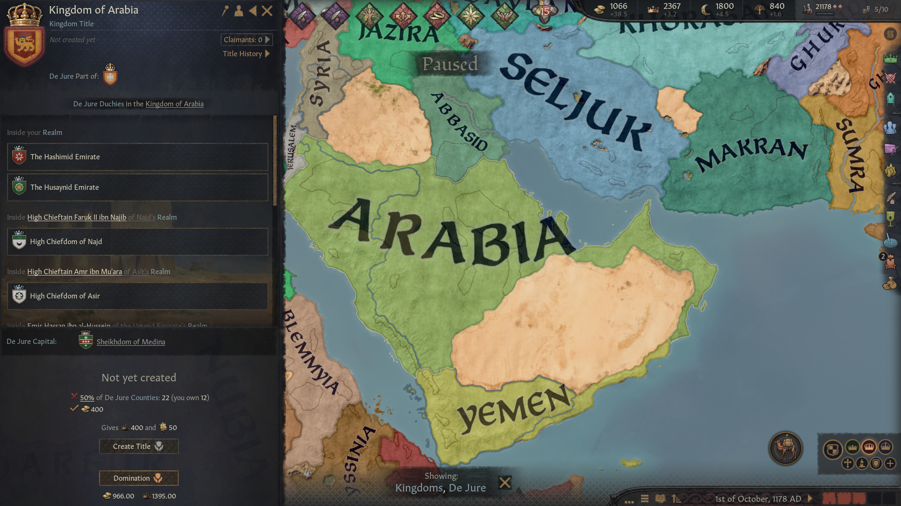
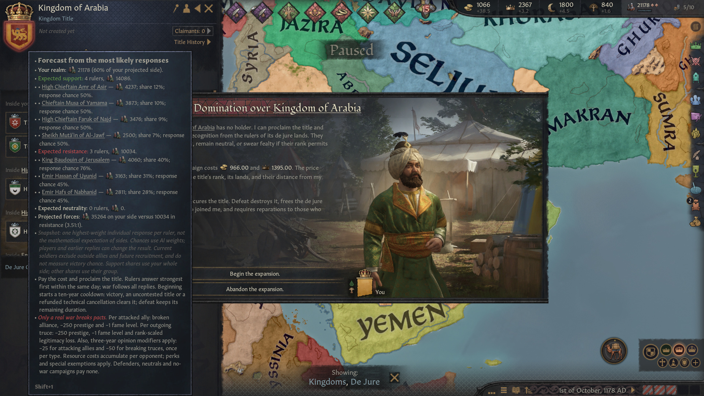

# Title Domination

## At a glance

- 🟢 **Version 0.1.1** · Targets CK3 **1.21.0.3**.
- 🟢 Independent landed rulers can proclaim an uncreated duchy, kingdom, empire or hegemony.
- 🟢 Choose which titles qualify, how second-phase wars work and how often AI rulers start campaigns.
- 🟢 **Languages:** English, French, German, Japanese, Korean, Polish, Russian, Simplified Chinese and Spanish.

## A crown worth fighting for

An empty throne can be yours if you can pay for the proclamation and convince the rulers who live under its banner. Some will bend the knee. Others will make you fight for the crown, then fight again for the land.

## Proclaim, negotiate, fight

- The **You can declare domination** decision lists affordable titles. Open a title to see the gold and prestige cost and a forecast of likely supporters, opponents and neutrals. The ordinary Create Title action takes priority when available.
- Paying the preparation cost creates the title. Local rulers can resist, stay neutral or swear fealty where their rank permits. A ruler of another faith may ask for religious protection. An oath promising protection takes effect only if the vassal contract can grant it.
- Resisters defend the title together in the first war. Victory secures your crown and voluntary vassals. Defeat destroys the title, releases the campaign’s de jure volunteers and pays reparations to the defenders.
- After a first-phase victory, keep what you have or press for the remaining de jure lands. The preparation cost is paid once. A defeated lower-ranking independent ruler becomes your direct vassal with their titles, lands and vassals, including holdings outside the contested title. Where vassalage is impossible, settlement covers only the disputed de jure lands. A second-phase defeat leaves you the crown and your voluntary vassals.
- Alliances and truces protect rulers from fighting one another. A ruler who swears fealty can stay home when their pacts rule out fighting. Rulers protected by treaty can remain neutral and keep their lands.

## Game rules

- **Eligible Titles** — all titles by default, titles with at least one de jure county in your realm, or titles containing your capital. A county held by your vassal counts toward the realm rule.
- **Subjugation Wars** — choose one common coalition, the default, or individual second-phase wars with separate peace settlements.
- **AI Campaign Frequency** — Off, Rare (default), Medium or Frequent. On Off, AI rulers still respond to your demands. Frequent gives each eligible ruler a 25% chance per quarter to consider a campaign. They still need peace, resources and sufficient forces.

## Getting started

1. Enable the mod and play an independent landed ruler at peace.
2. Open **You can declare domination** in Decisions, or go directly to an eligible uncreated title and select **Domination**.
3. Review the forecast and price. Confirm to issue the proclamation, then decide how to answer oaths and whether to pursue subjugation.

## Compatibility and load order

No other mod or DLC is required. The vanilla nomadic higher-tier decision remains available. This mod replaces **gui/window_title.gui**. Another mod replacing the same window needs a merged compatibility patch.

## Saves and known limits

Back up existing saves before adding or updating the mod. Keep it enabled while a campaign is active. Settlements from wars already concluded retain their original outcome. The forecast excludes outside allies and future recruitment. White peace and hostages cannot settle a domination war. Compatibility with total conversions and multiplayer is unverified.

## Feedback and support

Include the game/mod version, target title, involved rulers, active mods and steps to reproduce the issue.

- [Report an issue on GitHub](https://github.com/G4VV4KH/-CK3-Title-Domination/issues)
- **Email:** g4vv4kh@gmail.com

### [Want to support my work? Donate on Ko-fi 💛](https://ko-fi.com/g4vv4kh)

## Find this mod elsewhere

- [Steam Workshop](https://steamcommunity.com/sharedfiles/filedetails/?id=3828276945)
- [Paradox Mods](https://mods.paradoxplaza.com/mods/165141/Any)
- [Nexus Mods](https://www.nexusmods.com/crusaderkings3/mods/434)
- [GitHub](https://github.com/G4VV4KH/-CK3-Title-Domination)

## My other mods

### Standalone mods

- [Parley: The Negotiating Table](https://steamcommunity.com/sharedfiles/filedetails/?id=3811090081) — negotiate diplomatic agreements.
- [Marriage Calculation Assistant](https://steamcommunity.com/sharedfiles/filedetails/?id=3811100163) — compare and sort marriage candidates.
- [Your Own Hegemony](https://steamcommunity.com/sharedfiles/filedetails/?id=3811201582) — found a custom hegemony.
- [Vassalization Extended](https://steamcommunity.com/sharedfiles/filedetails/?id=3813943691) — choose Forced Vassalization terms without a county limit.
- [Court Automation](https://steamcommunity.com/sharedfiles/filedetails/?id=3814028714) — automate court positions and recruit courtiers or knights.
- [Nomad Autorefill](https://steamcommunity.com/sharedfiles/filedetails/?id=3814793283) — automatically reinforce nomadic Men-at-Arms using herd or gold.
- [Tax Collection Automation](https://steamcommunity.com/sharedfiles/filedetails/?id=3815381275) — automatically assign tax collectors and optimize tax jurisdictions.
- [Council Assignment Automation](https://steamcommunity.com/sharedfiles/filedetails/?id=3815689627) — automate council appointments and optimize councillor assignments.
- [Strategist Assistant](https://steamcommunity.com/sharedfiles/filedetails/?id=3827659479) — plan armies, recruitment and wars.
- [Accolade Workshop](https://steamcommunity.com/sharedfiles/filedetails/?id=3836819350) — choose accolade attributes or knights first and set rank limits.
- [Traitor Trials](https://steamcommunity.com/sharedfiles/filedetails/?id=3843236809) — judge defeated rebels after a war.

### Compatibility patches

- [[compatch] CAA + CA](https://steamcommunity.com/sharedfiles/filedetails/?id=3816373375) — use Council Assignment Automation and Council Autopilot together.

## Credits

Cover artwork was generated with AI. Gameplay screenshots were provided by the author.

## Screenshots

## Contributing

See [developer guidance](dev.md).
